# 10. データ設計

### 10.1 データ設計の概要

本システムでは、DHT11から取得した温度および湿度データをEdge Applicationで扱い、Cloudflare Workerを介してCloudflare D1へ保存する。

データ設計では、以下のデータを対象とする。

* センサーデータ
* センサーデータの時刻情報
* Edge Application内部で受け渡すデータ
* 通信処理に必要なデータ

具体的な保存方式およびデータ形式は、Edge ApplicationとCloudflare Workerのインターフェースを考慮して定義する。

### 10.2 センサーデータ

センサーデータは、DHT11から取得した温度および湿度を1つのデータ単位として扱う。

| 項目 | 内容 |
|---|---|
| Temperature | 温度 |
| Humidity | 湿度 |
| Timestamp | センサーデータを取得した時刻 |
| Data ID | SensorDataを識別するID |

センサーデータはSensor Processで取得され、POSIX Message Queueを介してCommunication Processへ渡される。

### 10.3 センサーデータ構造

Edge Application内部では、センサーデータを以下のSensorDataとして扱う。

| 項目 | C++型 | 単位 | 内容 |
|---|---|---|---|
| temperature | `double` | ℃ | DHT11から取得した温度。小数第1位までを有効値とする |
| humidity | `double` | %RH | DHT11から取得した湿度。小数第1位までを有効値とする |
| timestamp | `int64_t` | Unix time seconds | Raspberry Piで取得した時刻。UTC基準 |
| data_id | `uint64_t` | - | SensorDataを識別するID |

`data_id`はSensor ProcessでSensorData生成時に付与し、Retry時にも同一値を使用する。

`data_id`は単独でシステム全体の一意性を保証するものではなく、`timestamp`との複合キーによってSensorDataを識別する。

同一データの重複判定および保存時の識別には、`data_id`と`timestamp`の組み合わせを使用する。

温度・湿度はDHT11の測定能力を超える精度を意味しないものとし、内部値・JSON・D1保存・表示で小数第1位を基本とする。

### 10.4 データフロー

センサーデータは以下の流れで処理する。

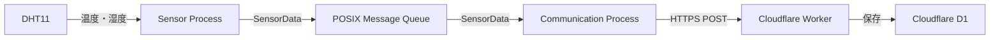

### 10.5 Cloudflare D1保存データ

Cloudflare D1には、センサーデータを履歴として保存する。

保存対象は以下とする。

| 項目 | 内容 |
|---|---|
| data_id | SensorDataを識別するID |
| temperature | DHT11から取得した温度。小数第1位 |
| humidity | DHT11から取得した湿度。小数第1位 |
| timestamp | Raspberry Piでの取得時刻。Unix time seconds、UTC基準 |

`data_id`と`timestamp`の組み合わせを重複排除に使用し、両方が一致するSensorDataは重複保存しない。

D1の物理的なSQL定義およびWorker内部実装は外部システムの実装詳細として扱うが、上記項目は本システムとのインターフェース上の確定データ項目とする。

### 10.6 データ保持方針

Cloudflare D1に保存されたセンサーデータは、Browserから現在値および履歴データを参照できるようにする。

Edge Application内部では、通信障害時のデータ保持をPOSIX Message QueueおよびCommunication Process内の一時保持に限定する。

以下の方針とする。

* IPC Message QueueのデータはQueue容量の範囲内で一時保持する
* Queue Full時は新規SensorDataを破棄する
* Communication ProcessでRetryを実施しても送信できなかったSensorDataは破棄する
* Queueの永続化は行わない
* Raspberry Pi再起動後に未送信データを復元しない
* 電源断やProcess停止によって未送信データが失われることを許容する

これにより、通信障害によるデータの無制限な蓄積を防止する。

### 10.7 データ整合性

センサーデータをCloudflare Workerへ送信する際には、温度と湿度を同一のセンサーデータとして扱う。

`timestamp`はSensor Processがセンサーデータを取得した時刻とし、Unix time seconds、UTC基準で管理する。

Cloudflare Workerでの受信時刻とは区別し、D1へ保存するセンサーデータの時刻にはRaspberry Piでの取得時刻を使用する。

同一SensorDataのRetryでは、`data_id`および`timestamp`を含む元のデータを維持する。

### 10.8 データ設計上の方針

データ構造は、Sensor Process、POSIX Message Queue、Communication ProcessおよびCloudflare Workerの間で一貫して扱えるようにする。

また、将来的にセンサー種類や測定項目が増加する可能性を考慮し、特定のセンサー実装に過度に依存しないデータ構造とする。

ただし、現時点ではDHT11による温度・湿度データを対象とし、不要な汎用化は行わない。

## 11. Queue / IPC設計

### 11.1 Queue / IPC設計の概要

本システムでは、センサーデータの取得処理とCloudflare Workerへの通信処理を異なるProcessに分離する。

Sensor ProcessはDHT11からセンサーデータを取得し、POSIX Message Queueを介してCommunication Processへセンサーデータを送信する。

Communication ProcessはPOSIX Message Queueからセンサーデータを受け取り、Cloudflare Workerへ送信する。

Process間のデータ受け渡しには、LinuxのPOSIX Message Queueを使用する。

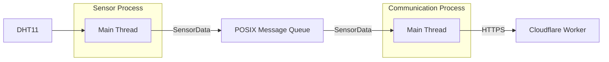

### 11.2 Process構成

Edge Applicationは、以下の2つのProcessを基本構成とする。

| Process | 主な責務 |
|---|---|
| Sensor Process | DHT11からセンサーデータを取得し、POSIX Message Queueへ送信する |
| Communication Process | POSIX Message Queueからセンサーデータを受信し、Cloudflare Workerへ送信する |

Processを分離することで、センサー処理と通信処理の障害影響範囲を分離する。

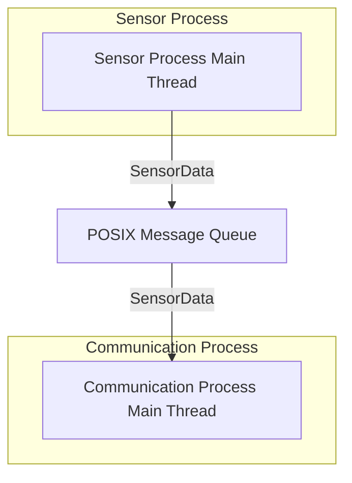

各Processの主処理はMain Threadで実行する。

Process間のデータ受け渡しはThread間通信ではなく、POSIX Message QueueによるProcess間通信とする。

### 11.3 Process分離の理由

Sensor ProcessとCommunication Processを分離する主な理由は、障害分離である。

通信処理では、以下のような処理が発生する可能性がある。

* HTTP Timeout
* DNS名前解決失敗
* Wi-Fi切断
* HTTP 4xx
* HTTP 5xx
* Retry
* Backoff

これらの処理によってCommunication Processが長時間処理を継続している場合でも、Sensor Processは独立してセンサーデータの取得を継続できる構成とする。

また、Communication Processが異常終了した場合でも、Sensor Process自体は独立して動作できる可能性がある。

ただし、Communication Processが停止した場合にはPOSIX Message Queueにデータが蓄積するため、Queue Fullへの対応が必要となる。

### 11.4 Sensor Process

Sensor Processは、DHT11とのインターフェースおよびセンサーデータ生成を担当する。

主な責務は以下とする。

* DHT11から温度を取得する
* DHT11から湿度を取得する
* センサーデータの妥当性を確認する
* SensorDataを生成する
* SensorDataをPOSIX Message Queueへ送信する
* センサー異常を検出する
* 必要なログを出力する

Sensor Processは、Cloudflare Workerとの通信処理を直接実行しない。

### 11.5 Communication Process

Communication Processは、クラウド側との通信を担当する。

主な責務は以下とする。

* POSIX Message QueueからSensorDataを受信する
* SensorDataをCloudflare Workerへ送信する
* HTTP通信結果を確認する
* Timeoutを検出する
* HTTPエラーを処理する
* Retryを実行する
* Backoffを実行する
* 通信異常を記録する

Communication Processは、DHT11へ直接アクセスしない。

### 11.6 IPC方式

Process間のデータ受け渡しに使用するIPC方式について、以下の候補を比較する。

| IPC方式 | 特徴 | 今回の適合性 |
|---|---|---|
| Pipe | 単純なProcess間データ通信が可能 | ○ |
| FIFO | 名前付きPipeとして利用可能 | ○ |
| Unix Domain Socket | 双方向通信が可能 | ○ |
| Shared Memory | 高速な共有メモリを実現できる | △ |
| Message Queue | メッセージ単位の通信が可能 | ◎ |

本システムでは、LinuxのPOSIX Message Queueを使用する。

SensorDataという明確なデータ単位をProcess間で受け渡すため、Message Queueによるメッセージ単位の通信が適している。

POSIX Message QueueのAPIおよび具体的な実装方法は、プログラム設計で定義する。

### 11.7 IPC Queueの構成

IPC Queueは、Sensor ProcessとCommunication Processの間に配置する。


Sensor ProcessはProducerとして動作する。

Communication ProcessはConsumerとして動作する。

### 11.8 IPCに格納するデータ

POSIX Message QueueにはSensorDataを格納する。

```text
SensorData
├── temperature
├── humidity
├── timestamp
└── data_id
```

IPCで受け渡すデータ項目および型は、10.3で定義したSensorDataに従う。

Process間でデータを受け渡すため、IPCで送受信可能なデータ表現を使用する。

POSIX Message Queueへの格納形式、シリアライズ方式およびデータサイズの具体的な実装方法は、プログラム設計で定義する。

### 11.9 IPC Queueの容量

POSIX Message Queueの最大容量は100件とする。

Queue容量100件により、通常の通信遅延を吸収しつつ、通信障害が長期化した場合に無制限にデータが蓄積することを防止する。

SensorData取得周期は5秒であるため、Queueが満杯の場合は最大500秒相当の取得データを保持する容量となる。

### 11.10 IPC Queue Full時の処理

POSIX Message QueueがFullになった場合、新しく生成したSensorDataを破棄する。

古いデータを削除して新しいデータを格納する方式、Queueが空くまでSensor Processを無期限に待機させる方式、ローカルストレージへ退避する方式は採用しない。

Queue Full発生時はErrorレベルのログを出力し、Sensor Processは次の周期処理へ移行する。

### 11.11 IPC Queue Empty時の処理

Communication ProcessがPOSIX Message Queueからデータを取得しようとした際にQueueがEmptyの場合、CPUを消費し続けるBusy Loopは避ける。

Communication Processは、データが到着するまで待機できる方式を基本とする。

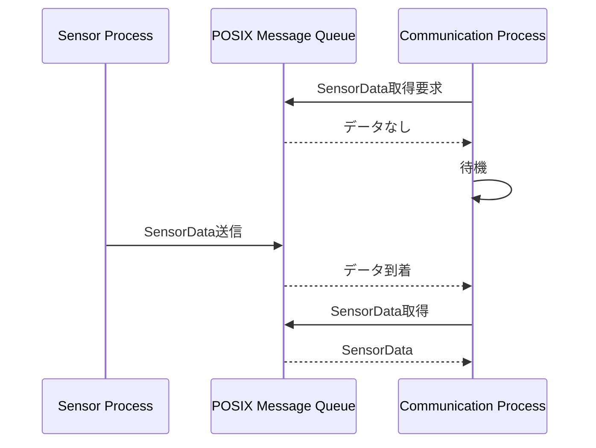

具体的な待機方式は、POSIX Message Queueの仕様に合わせてプログラム設計で定義する。

### 11.12 データ順序

POSIX Message Queueに格納されたSensorDataは、原則としてFIFOで処理する。

```text
SensorData A
SensorData B
SensorData C

        ↓

POSIX Message Queue

        ↓

A → B → C
```

Sensor Processで取得した順序をCommunication Processで維持することを基本とする。

ただし、通信失敗時のRetryや再送が発生した場合、送信完了順序が変化する可能性がある。

Retryおよび再送時の順序については、通信設計および障害復旧設計で定義する。

### 11.13 Process間のメモリ分離

Sensor ProcessとCommunication Processは、それぞれ独立したProcessとして動作する。

そのため、通常のThread間共有メモリのようにSensorDataを直接共有することはできない。

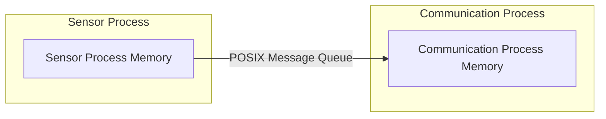

このメモリ分離により、一方のProcessが異常終了した場合でも、もう一方のProcessのメモリ空間へ直接影響を与えない構造とする。

### 11.14 Process異常終了への考慮

Processを分離することで、Process単位で異常終了を検出し、復旧することが可能となる。

例えばCommunication Processが異常終了した場合、Sensor Processは独立して動作を継続できる。

一方、Communication Processが停止している間はPOSIX Message Queueにデータが蓄積する。

そのため、Process異常終了時には以下を考慮する必要がある。

* 異常終了の検出
* Process再起動
* POSIX Message Queueの状態
* 未送信データの扱い
* Queue Fullへの対応
* Sensor Processへの影響

具体的な復旧方法は、障害復旧設計およびsystemd設計で定義する。

### 11.15 systemdとの関係

Sensor ProcessとCommunication Processを別Processとして構成し、それぞれのProcessをsystemdから管理する。

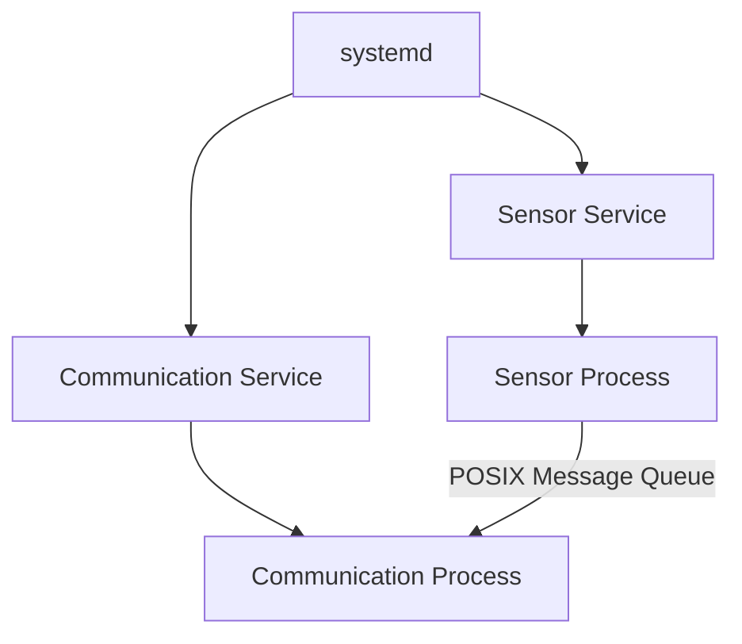

この構成では、Communication Processだけを個別に再起動することが可能になる。

POSIX Message Queueの生成はSensor Processが担当する。

Sensor ProcessはQueueを生成し、Communication Processは既存のQueueへ接続する。

Communication ProcessはQueueが存在しない場合、一定時間待機した後に接続を再試行する。

Process間の起動順序、Queueの生成・オープン、停止順序および異常終了時の復旧方式は、19章のsystemd設計および18章のLifecycle設計で定義する。

### 11.16 IPCのメリット

Sensor ProcessとCommunication Processを分離し、Process間IPCで連携することで、以下のメリットが得られる。

* Process単位で障害を分離できる
* Sensor処理と通信処理を独立させられる
* Communication Processだけを再起動できる構成にできる
* Processごとに責務を明確化できる
* メモリ空間を分離できる
* systemdによるProcess単位の監視と相性がよい

### 11.17 IPCのデメリット

一方で、Sensor ProcessとCommunication Processを分離し、Process間IPCで連携する構成には、以下のデメリットがある。

* IPCの実装が必要になる
* Process間のデータ形式を定義する必要がある
* シリアライズなどの処理が必要になる
* IPC障害を考慮する必要がある
* Process起動順序を考慮する必要がある
* Process終了時のQueue処理が複雑になる
* systemdとの責務分担が必要になる
* システム全体の構成が複雑になる

### 11.18 Process / IPC構成の基本方針

以下の構成を基本方針とする。

| 項目 | 方針 |
|---|---|
| Sensor処理 | Sensor Process |
| Communication処理 | Communication Process |
| Process間通信 | IPC |
| IPC方式 | POSIX Message Queue |
| Producer | Sensor Process |
| Consumer | Communication Process |
| データ単位 | SensorData |
| データ順序 | FIFO |
| Queue容量 | 100件 |
| Queue Empty | データ到着までブロッキング待機 |
| Queue Full | 新規SensorDataを破棄する |
| Process間メモリ共有 | 直接共有しない |
| Process監視 | systemdと連携する |
| Queue生成 | Sensor Process |
| Queue接続 | Communication Process |

### 11.19 Queue / IPC設計の決定事項

- IPC方式はPOSIX Message Queueとする
- Queue容量は100件とする
- Queue Full時は新規SensorDataを破棄する
- Queue Full時にSensor Processを無期限待機させない
- Queueからのデータ取り出し順序はFIFOとする
- Process間のメモリ共有は行わず、POSIX Message Queueをインターフェースとする
- Queueの永続化は行わない
- POSIX Message Queueの生成はSensor Processが担当する
- Communication Processは既存Queueへ接続する
- Communication ProcessはQueue不存在時に接続を再試行する

## 12. 周期・タイミング設計

### 12.1 周期・タイミング設計の概要

本システムでは、DHT11からのセンサーデータ取得およびCloudflare Workerへのデータ送信を継続的に実行する。

Sensor ProcessとCommunication Processは、それぞれ異なる処理特性を持つため、処理タイミングを分離して設計する。

Sensor Processは一定周期でDHT11からセンサーデータを取得する。

Communication ProcessはPOSIX Message Queueからのデータ到着を待機し、SensorDataを受信したらCloudflare Workerへ送信する。

周期値、Timeout、RetryおよびBackoffは、本章で定義する。

### 12.2 センサーデータ取得周期

Sensor Processは5秒周期でDHT11から温度および湿度を取得する。

5秒周期はDHT11の測定間隔を満たし、現在値および履歴表示に必要な更新頻度を確保する値とする。

Linux環境であるため、実際の取得時刻にはスケジューリング遅延が発生し得る。周期の厳密なリアルタイム性は要求しない。

### 12.3 センサーデータ取得処理

Sensor Processでは、以下の処理を1周期の基本単位とする。

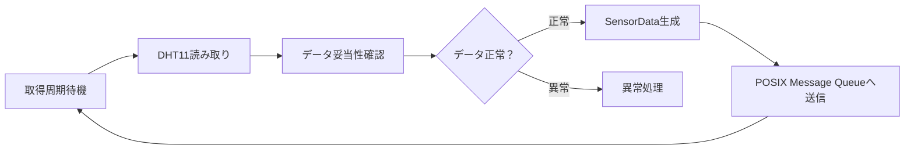

センサー読み取りに失敗した場合は、SensorDataをPOSIX Message Queueへ送信せず、異常処理へ移行する。

具体的なセンサー異常時の復旧方法については、異常系設計および障害復旧設計で定義する。

### 12.4 取得周期の基準

周期処理は、単純な「処理完了後に一定時間待つ」方式だけでなく、処理時間による周期ずれを考慮する。

例えば以下のような方式がある。

```text
方式A

[取得] → [処理] → [待機] → [取得] → [処理] → [待機]

方式B

|<------ 一定周期 ------>|<------ 一定周期 ------>|
[取得]                    [取得]
```

本システムでは、
- 5秒周期は、前回の取得開始時刻を基準とする。
- 処理時間による周期ずれが累積しない方式を採用する。
- Linuxのスケジューリング遅延による多少の遅れは許容する。
- ハードリアルタイム性は要求しない。

### 12.5 Communication Processの処理方式

Communication ProcessはPOSIX Message QueueからSensorDataを待ち受けるブロッキング方式を基本とする。

SensorDataを取得した場合は直ちに送信処理を開始し、送信失敗時は13章で定義するRetry / Backoffを実行する。

### 12.6 通信処理とセンサー取得処理の分離

Sensor ProcessとCommunication Processを別Processとすることで、以下の処理を時間的に分離する。

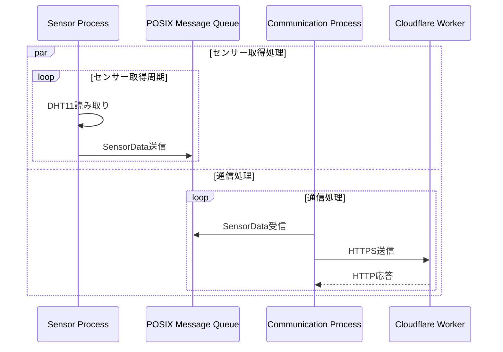

通信処理がTimeoutやRetryによって長時間継続した場合でも、Sensor Processは独立してセンサーデータ取得を継続できる構成とする。

ただし、Communication Processの処理速度がSensor Processの生成速度を下回った場合、POSIX Message Queueにデータが蓄積する。

このため、Queue容量およびQueue Full時の処理については、11章および後続の異常系設計と整合させる。

### 12.7 データ送信タイミング

Communication ProcessはPOSIX Message QueueからSensorDataを取得した時点で送信処理を開始する。

Sensor ProcessとCommunication Processの周期を同期させる方式は採用しない。

### 12.8 通信処理時間が長い場合

Communication ProcessのHTTP通信に時間がかかる場合、次のSensorDataがPOSIX Message Queueに蓄積する。

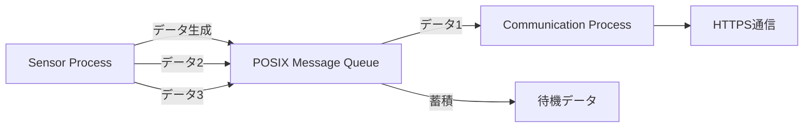

この状態が一時的であれば、Queueによって吸収する。

通信遅延が長期化した場合には、Queue容量100件を超える可能性がある。Queue Full時には、第11章で定義したとおり、新規SensorDataを破棄する。

### 12.9 RetryおよびBackoffとの関係

通信失敗が発生した場合、Communication ProcessはRetryを実行する可能性がある。

Retry中はCommunication Processの処理時間が増加するため、POSIX Message Queueへのデータ蓄積量が増加する可能性がある。

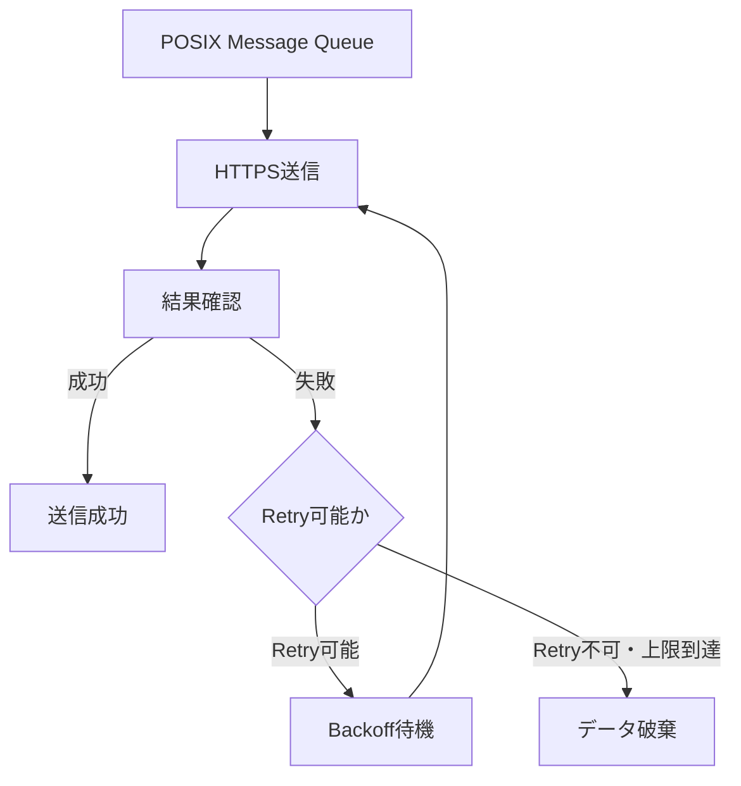

Retry回数、Backoff時間およびRetry対象となるエラーについては、13章「通信設計」で定義する。

### 12.10 周期とQueue容量の関係

Sensor Processの取得周期をTs、Communication ProcessがSensorDataを1件処理するために必要な平均処理時間をTcとした場合、長期的に以下の関係となることが望ましい。

```text
Tc < Ts
```

Tcには、HTTP通信時間だけでなく、RetryおよびBackoffに要する時間を含む。

Communication Processの平均処理能力がSensor Processのデータ生成速度を上回ることで、通常時にQueueへデータが蓄積し続けることを防止する。

ただし、ネットワーク障害やCloudflare側の障害などによって一時的にTcが増加する場合がある。

そのため、通常時の処理能力だけではなく、通信障害発生時のQueue蓄積量についても考慮する。

### 12.11 周期設計における時間精度

本システムは、リアルタイムOSではなくRaspberry Pi OS上のLinux環境で動作する。

そのため、OSスケジューリングやシステム負荷の影響により、処理の実行タイミングに多少の遅延が発生する可能性がある。

Sensor Processは、前回の取得開始時刻を基準として約5秒間隔でセンサーデータを取得する。ただし、Linux環境であるため、実際の取得開始時刻にはスケジューリング遅延が発生し得る。

Communication Processは、POSIX Message QueueからSensorDataを取得したことを契機として送信処理を開始する。通信処理の実行タイミングは、センサー取得周期とは同期しない。

本システムではハードリアルタイム性を要求せず、Linux環境で発生する多少の実行遅延を許容する。

### 12.12 Process起動時のタイミング

systemdがSensor ProcessおよびCommunication Processを起動する。

POSIX Message Queueの生成はSensor Processが担当する。

Sensor ProcessはQueueを生成し、Communication Processは既存のQueueへ接続する。

Communication ProcessがSensor Processより先に起動した場合、Queueが存在しないため、一定時間待機した後に接続を再試行する。

Communication ProcessはQueueへの接続に成功した後、SensorDataの受信処理を開始する。

Sensor Processは初期化完了後に最初のセンサー取得を開始し、その取得開始時刻を基準として以降5秒周期で取得処理を実行する。

### 12.13 Process停止時のタイミング

正常Shutdownでは、Sensor Processへの停止要求を先に行い、新規SensorDataの生成を停止する。

その後、Communication Processへの停止要求を行い、通信処理を終了する。

Shutdown時にQueueに残っているSensorDataは永続化せず、破棄する。また、Communication Processが処理中のSensorDataについても、Shutdown時の処理終了に伴い送信が完了しない場合があることを許容する。

Communication Processの停止処理および終了期限については、Lifecycle設計およびsystemd設計で定義する。

### 12.14 周期・タイミングに関する基本方針

以下を基本方針とする。

| 項目 | 方針 |
|---|---|
| センサー取得 | Sensor Processで周期実行 |
| センサー取得周期 | 約5秒 |
| 周期基準 | 前回の取得開始時刻を基準とする |
| データ生成 | センサー取得ごとにSensorDataを生成 |
| IPC送信 | SensorData生成後に実行 |
| 通信処理 | Communication Processで実行 |
| 通信タイミング | POSIX Message Queueからデータを取得した時点で送信 |
| Sensor / Communication周期 | 独立させる |
| 通信遅延 | POSIX Message Queueで一時的に吸収する |
| Queue容量 | 100件 |
| Queue Full時 | 新規SensorDataを破棄する |
| Retry | Communication Processで実行 |
| Backoff | Communication Processで実行 |
| リアルタイム性 | ハードリアルタイム性は要求しない |
| 周期精度 | Linux環境でのスケジューリング遅延を許容する |

### 12.15 周期・タイミング設計の決定事項

| 項目 | 決定値 |
|---|---|
| DHT11取得周期 | 5秒 |
| Sensor Process周期方式 | 前回の取得開始時刻を基準とする周期方式（方式B） |
| 周期精度 | Linux環境でのスケジューリング遅延を許容し、ハードリアルタイム性は要求しない |
| Communication Process待機方式 | POSIX Message Queueのブロッキング待機 |
| データ送信タイミング | Queueから取得後、直ちに送信開始 |
| HTTP Timeout | 5秒 |
| Retry回数 | 初回送信を除き最大3回 |
| 最大送信試行回数 | 初回送信を含め最大4回 |
| Retry間隔 | 1秒 → 2秒 → 4秒 |
| Backoff | Exponential Backoff、最大4秒 |
| Queue容量 | 100件 |
| Queue Full時 | 新規SensorDataを破棄する |
| Shutdown時のQueue内データ | 永続化せず破棄 |
| Shutdown時の処理中データ | Shutdown時に送信が完了しない場合があることを許容する |

## 13. 通信設計

### 13.1 通信設計の概要

本システムでは、Communication Processがネットワークを介してCloudflare WorkerとHTTPS通信を行う。

Raspberry Pi 4BからCloudflare Workerへセンサーデータを送信し、Cloudflare WorkerからHTTPレスポンスを受信する。

通信経路は以下とする。

```mermaid
flowchart LR
    Sensor["Sensor Process"]
    IPC["POSIX Message Queue"]
    Comm["Communication Process"]
    WiFi["Wi-Fi / Internet"]
    Worker["Cloudflare Worker"]
    D1["Cloudflare D1"]

    Sensor -->|SensorData| IPC
    IPC -->|SensorData| Comm
    Comm -->|HTTPS Request| WiFi
    WiFi --> Worker
    Worker --> D1
    Worker -->|HTTPS Response| WiFi
    WiFi --> Comm
```

### 13.2 通信方式

Cloudflare Workerとの通信にはHTTPSを使用する。

Communication Processは、SensorDataをHTTPS RequestとしてCloudflare Workerへ送信する。

Cloudflare WorkerはRequestを受信し、処理結果をHTTP Responseとして返却する。

センサーデータ送信にはHTTP POSTを使用することを基本方針とする。

### 13.3 通信方向

通信方向は以下とする。

| 通信 | 方向 | 用途 |
|---|---|---|
| SensorData送信 | Raspberry Pi → Cloudflare Worker | センサーデータの保存 |
| Response受信 | Cloudflare Worker → Raspberry Pi | 送信結果の通知 |

BrowserからCloudflare Workerへのデータ参照については、システムコンテキストおよびシステムアーキテクチャで定義しているが、本章ではRaspberry Pi側の通信を中心に扱う。

### 13.4 HTTP Request

Communication Processは、POSIX Message Queueから取得したSensorDataをHTTPS POST RequestとしてCloudflare Workerへ送信する。

| 項目 | 決定値 |
|---|---|
| Method | POST |
| Protocol | HTTPS |
| Content-Type | application/json |
| Endpoint | Cloudflare WorkerのSensorData受信Endpoint |
| Authentication | 専用HTTP HeaderにShared Secretを設定 |
| Body | data_id、temperature、humidity、timestamp |

### 13.5 HTTP Body

HTTP RequestのBodyには以下のJSON形式を使用する。

```json
{
  "data_id": 1,
  "temperature": 25.4,
  "humidity": 60.0,
  "timestamp": 1750000000
}
```

`data_id`は`uint64_t`に対応する整数値、`temperature`および`humidity`は小数第1位、`timestamp`はUnix time secondsを使用する。

重複判定には`data_id`と`timestamp`の組み合わせを使用する。

### 13.6 HTTP Response

Cloudflare Workerから返却されるHTTP ResponseをCommunication Processで確認する。

Communication Processでは、少なくとも以下を判定対象とする。

* HTTP通信自体の成功・失敗
* HTTP Status Code
* Response受信の成否

HTTP Status Codeに応じて、センサーデータの送信成功、再送対象、恒久的なエラーなどを判定する。

### 13.7 HTTP Status Codeの扱い

HTTP Status Codeは、以下のように分類する。

| Status Code | 分類 | 基本方針 |
|---|---|---|
| 2xx | 成功 | データ送信成功として処理 |
| 4xx | クライアント側エラー | 原則としてRetry対象外 |
| 5xx | サーバー側エラー | Retry対象候補 |
| その他 | 想定外 | 異常として処理 |

具体的なStatus Codeごとの処理については、異常系設計で定義する。

### 13.8 Timeout

HTTPS通信全体のTimeoutは5秒とする。

このTimeoutは、通信処理開始からHTTP Responseの受信完了までの上限時間とする。

DNS名前解決、TCP接続、TLS接続確立、Request送信およびResponse受信を含む。

通信開始から5秒以内にResponseの受信が完了しない場合はTimeoutとして扱い、Retry対象とする。

### 13.9 DNS名前解決

DNS名前解決に失敗した場合は通信失敗として扱い、Retry対象とする。

Retryは最大3回とし、1秒、2秒、4秒の間隔で実施する。

### 13.10 Wi-Fi / Network障害

ネットワーク接続が失われた場合、Cloudflare Workerへの通信は失敗する。

Network障害そのものをCommunication Processが直接復旧させるのではなく、Communication Processは通信失敗を検出し、必要なRetry処理を行う。

ネットワーク接続自体の管理および復旧は、Raspberry Pi OSおよびネットワーク管理機構との責務分担を考慮する。

### 13.11 Retry

一時的な通信障害に対してCommunication Processは最大3回のRetryを実行する。初回送信はRetry回数に含めない。

Retry対象は以下とする。

- DNS名前解決失敗
- TCP/TLS接続失敗
- HTTPS通信全体のTimeout
- HTTP応答Timeout
- HTTP 5xx

以下は原則としてRetryしない。

- HTTP 400
- HTTP 401
- HTTP 403
- HTTP 404

Retryを3回実施しても送信できない場合は、そのSensorDataを破棄し、異常ログを出力して次のQueueデータ処理へ移行する。

### 13.12 Backoff

Retry間隔にはExponential Backoffを使用する。

```text
初回送信失敗
  ↓ 1秒
Retry 1
  ↓ 2秒
Retry 2
  ↓ 4秒
Retry 3
```

最大Backoff時間は4秒とする。

### 13.13 RetryとIPC Queue

Communication ProcessがRetryを実行している間、Sensor Processは独立して動作する。

そのため、新しく取得されたSensorDataはPOSIX Message Queueへ格納される。


Retryが長時間継続した場合、POSIX Message Queueのデータ量が増加する可能性がある。

このため、Retry設計はQueue容量およびQueue Full時の処理と整合させる。

### 13.14 送信成功時の処理

Cloudflare Workerから正常なHTTP Responseを受信した場合、Communication Processは対象SensorDataの送信成功と判断する。

送信成功したSensorDataは、通常のPOSIX Message Queueからは削除済みのデータとして扱う。

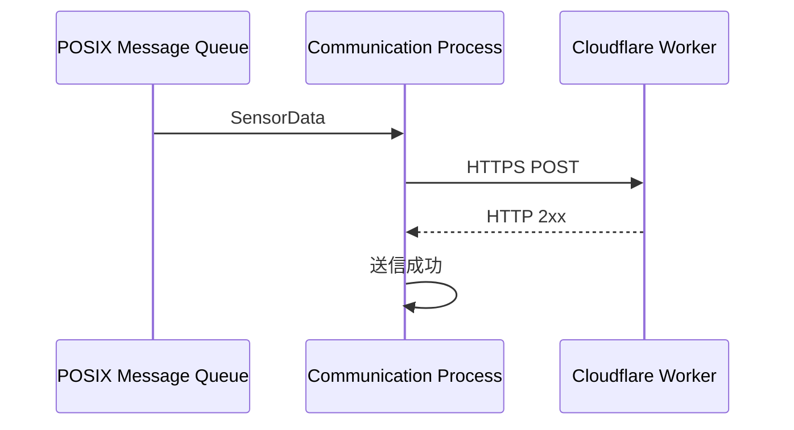

### 13.15 送信失敗時の処理

送信失敗時にはエラー種別を判定する。

- Retry対象：Retry / Backoffを実施する
- Retry対象外の4xx：対象SensorDataを破棄し、異常ログを出力する
- Retry上限到達：対象SensorDataを破棄し、異常ログを出力する
- 想定外エラー：異常ログを出力し、対象SensorDataを破棄する

送信失敗したSensorDataをPOSIX Message Queueへ戻す方式は採用しない。

### 13.16 通信の再送と重複データ

HTTPS Request送信後にResponseを受信できなかった場合、Cloudflare Worker側では保存処理が完了している可能性がある。そのため、Retry時には同一の`data_id`および`timestamp`を使用する。

Cloudflare Worker側では`data_id`と`timestamp`の組み合わせを重複排除キーとして扱い、同一の組み合わせを持つSensorDataを複数回受信してもD1へ重複保存しない。

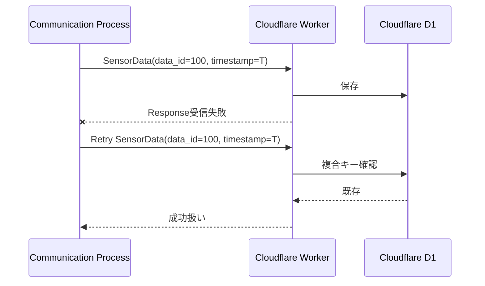

### 13.17 通信状態

Communication Processでは、通信状態を管理できる構造とする。

通信状態は、以下の状態で管理する。

```text
通信可能
   ↓
通信失敗
   ↓
Retry中
   ↓
Backoff
   ↓
通信再開
```

通信状態の詳細な状態遷移については、14章「状態遷移設計」で定義する。

### 13.18 セキュリティ

Raspberry PiからCloudflare Workerへの通信にはHTTPSを使用する。

SensorData送信時には専用HTTP HeaderへShared Secretを設定し、Worker側で認証する。Shared SecretはC++ソースコードへ埋め込まない。

秘密情報の保管方法は20章で定義する。

### 13.19 通信失敗時のデータ保持

通信失敗時のSensorDataは、最大3回のRetry期間中のみCommunication Processが保持する。

Retry失敗後のSensorDataは破棄し、ファイルやSQLite等への永続保存は行わない。

これにより、通信障害による無制限のデータ蓄積を防止する。

### 13.20 通信設計の基本方針

| 項目 | 方針 |
|---|---|
| 通信プロトコル | HTTPS |
| データ送信 | HTTP POST |
| データ形式 | JSON |
| 認証 | 専用HTTP HeaderのShared Secret |
| Timeout | HTTPS通信全体で5秒 |
| HTTP 2xx | 送信成功 |
| HTTP 4xx | 原則Retry対象外 |
| HTTP 5xx | Retry対象 |
| DNS失敗 | Retry対象 |
| 接続失敗 | Retry対象 |
| Timeout | Retry対象 |
| Retry | 最大3回 |
| Retry間隔 | 1秒 → 2秒 → 4秒 |
| Backoff | Exponential Backoff、最大4秒 |
| Retry失敗後 | SensorDataを破棄して次データへ移行 |
| 重複排除 | data_idとtimestampの組み合わせを使用 |
| 通信障害時の永続保存 | 行わない |

### 13.21 通信設計の決定事項

本章で定義した通信方式、HTTP Request、JSON形式、Timeout、Retry、Backoff、認証、重複排除、通信失敗時のデータ処理を本設計の確定事項とする。

Cloudflare Workerの具体的なURLなど環境固有の値は実装・配置時に設定するが、通信方式およびデータ契約は本章の定義から変更しない。