# 06_system_management_security.md

## 19. systemd設計

### 19.1 目的

本章では、Raspberry Pi OS上で動作するEdge Applicationの各Processについて、systemdによる起動、停止、異常終了時の再起動、OS起動時の自動起動、およびログ管理の基本方針を定義する。

対象とするProcessは以下の2つとする。

- Sensor Process
- Communication Process

systemdは、これらのProcessをOS上のサービスとして管理する。

### 19.2 systemdの役割

systemdは、本システムにおいて以下を担当する。

- Raspberry Pi起動時のProcess自動起動
- Processの起動管理
- Processの停止管理
- Processの異常終了検出
- Process異常終了時の再起動
- Processの終了状態管理
- systemd journalへのログ集約
- Raspberry Pi再起動後のProcess復旧

systemdはアプリケーション内部の処理を管理するものではない。

Sensor Process内部のセンサー取得処理や、Communication Process内部のHTTP通信、Retry、Backoffなどは各Process自身が管理する。

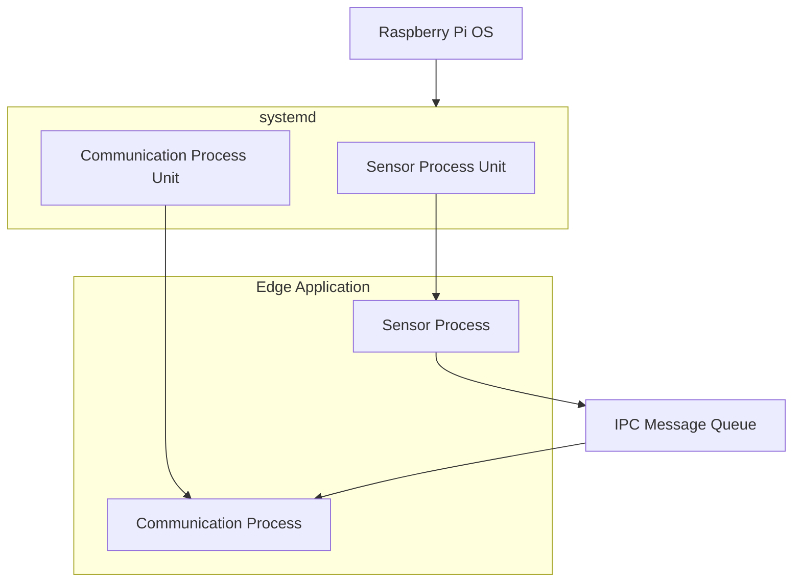

### 19.3 Unit構成

Sensor ProcessとCommunication Processは、それぞれ独立したsystemd Unitとして管理する。

想定するUnit構成は以下とする。

| Unit | 管理対象 | 役割 |
|---|---|---|
| sensor-process.service | Sensor Process | DHT11からのデータ取得 |
| communication-process.service | Communication Process | IPCからデータを受信しWorkerへ送信 |

Unitを分離することで、片方のProcessに異常が発生した場合でも、もう片方のProcessを独立して管理できる構成とする。

### 19.4 OS起動時の自動起動

Raspberry Pi OSの通常起動時には、Sensor ProcessおよびCommunication Processを自動起動する。

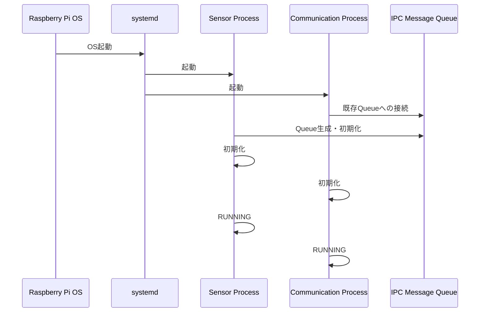

OS起動後にユーザーが手動でProcessを起動する必要がない構成とする。

各Processの起動順序に依存せず、IPC Message Queueの利用準備が完了した後に通常処理へ移行できる構成とする。

### 19.5 起動順序

Sensor ProcessとCommunication Processは独立したProcessとして起動する。

ただし、IPC Message Queueの生成・接続については、以下の責務分担を適用する。

#### Sensor Process

- IPC Message Queueの生成・管理を担当する。
- 起動時にQueueを生成、または既存Queueへ接続する。
- Queueの初期化が完了してからセンサー取得を開始する。

#### Communication Process

- 既存IPC Message Queueへの接続を担当する。
- Queueが存在しない場合はQueueを生成しない。
- Queueが存在しない場合は一定間隔で接続を再試行する。
- Queueへの接続が完了してから通常の受信処理を開始する。

#### 基本方針

- Queueの生成・管理はSensor Processに限定する。
- Queueへの接続はCommunication Processが担当する。
- Process起動順序によって正常動作できなくなる構成にはしない。
- Queue不存在を直ちにProcessの恒久的な異常として扱わない。
- Queueアクセスに関する恒久的な異常は、エラー処理方針に従って扱う。

### 19.6 systemdの依存関係

systemdでは、Unit間の依存関係および起動・停止順序を設定できる。

本システムでは、Sensor ProcessとCommunication Processを完全な親子関係にはしない。

Sensor ProcessがCommunication Processを直接起動する構成にはしない。

同様に、Communication ProcessがSensor Processを直接起動する構成にもならない。

両Processはsystemdによって管理され、それぞれが独立して動作する。

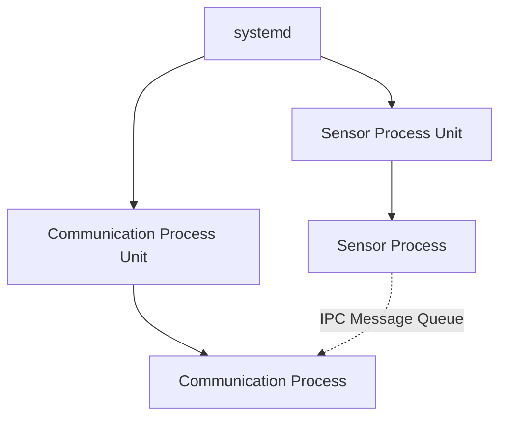

Unit間の起動・停止順序は、IPCの生成・接続およびShutdown時のデータフローを考慮して設定する。

Process同士が相手Processのライフサイクルを直接管理しない構成とする。

### 19.7 Network依存

Communication ProcessはCloudflare Workerとの通信にWi-Fi / Internetを使用する。

ただし、Communication Processの起動条件にNetwork Onlineを必須としない。

OS起動直後にネットワークが利用できない場合でも、Communication Process自体は起動できる構成とする。

通信処理開始時にネットワークが利用できない場合は、通信異常として扱い、Communication Process内部のRetry / Backoffによって復旧を待つ。


Network OnlineをUnitの必須依存条件にはしない。

これにより、Wi-Fi接続完了のタイミングにProcess起動を過度に依存しない構成とする。

### 19.8 異常終了時の再起動

Processが異常終了した場合、systemdによる自動再起動を行う。

| 状態 | systemdの動作 |
|---|---|
| 正常終了 | 再起動しない |
| 異常終了 | 再起動する |
| 起動失敗 | 再起動を試みる |
| OS再起動 | OS起動後に自動起動する |
| StartLimit到達 | 自動再起動を抑制する |

Restart設定は `Restart=on-failure` を基本とする。

Process内部で検出した一時的なセンサーエラーや通信エラーについては、Process自身が処理する。

Process全体の継続が困難となり異常終了した場合は、systemdによる再起動対象とする。

### 19.9 再起動待ち時間

Process異常終了後の再起動待ち時間は5秒とする。

systemd Unitでは以下を設定する。

```ini
Restart=on-failure
RestartSec=5
```

```text
Process異常終了
    ↓
systemd検出
    ↓
5秒待機
    ↓
Process再起動
```

これにより、異常終了直後の連続的な再起動を抑制する。

### 19.10 Processの連続異常終了

Processに恒久的な問題が存在する場合、再起動を繰り返す可能性がある。

```text
起動
 ↓
異常終了
 ↓
再起動
 ↓
異常終了
 ↓
再起動
 ↓
異常終了
 ↓
・・・
```

このような無制限の再起動ループを避けるため、systemdのStartLimit設定を利用する。

本システムでは、以下を基本設定とする。

| 設定項目 | 設定値 | 内容 |
|---|---|---|
| StartLimitIntervalSec | 60 | 起動回数を判定する時間 |
| StartLimitBurst | 5 | 上記時間内に許可する起動回数 |
| RestartSec | 5 | 再起動までの待ち時間 |

Unitには以下の設定を適用する。

```ini
[Unit]
StartLimitIntervalSec=60
StartLimitBurst=5
```

60秒以内に5回を超える起動が発生した場合は、systemdによる再起動を抑制する。

StartLimit到達後は異常状態として扱い、ログから原因を調査する。

原因を解消した後、必要に応じて `systemctl reset-failed` によって失敗状態を解除し、Processを再起動する。

StartLimit到達を解消する目的だけで、Raspberry Pi全体を自動再起動する構成にはしない。

### 19.11 Process異常とシステム異常の分離

Process異常が発生した場合でも、直ちにRaspberry Pi全体を再起動する構成にはしない。

基本的な復旧階層は以下とする。

```text
Process異常
    ↓
Process再起動
    ↓
復旧確認
    ↓
正常動作
```

Process再起動でも復旧できない場合には、異常状態として記録する。

Raspberry Pi全体の再起動は、Process単体では解決できないシステムレベルの問題に対する手段として扱う。

この考え方は、16章「障害復旧設計」と整合させる。

### 19.12 Sensor Process再起動時の動作

Sensor Processが異常終了した場合、systemdはSensor Processを再起動する。

再起動後、Sensor Processは初期化処理を再実行する。

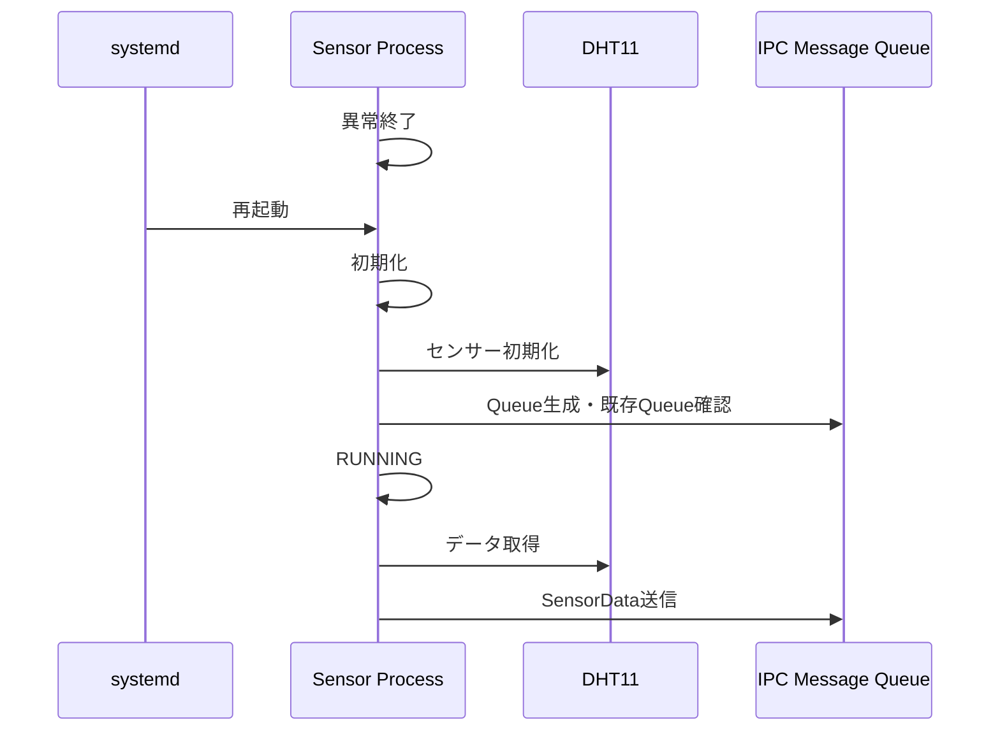

再起動時に、それ以前のSensor Process内部状態をそのまま引き継ぐことは前提としない。

必要な状態は初期化処理によって再構築する。

IPC Message Queueが既に存在する場合は、既存Queueを利用する。

Process再起動時に、既存Queue内のデータを無条件に削除・再生成しない。

### 19.13 Communication Process再起動時の動作

Communication Processが異常終了した場合、systemdはCommunication Processを再起動する。

再起動後は以下を実行する。

- Process初期化
- 通信関連リソースの初期化
- 既存IPC Message Queueへの接続
- QueueからのSensorData受信
- Cloudflare Workerへの送信再開

Sensor ProcessはCommunication Processの異常終了によって直接終了させない。

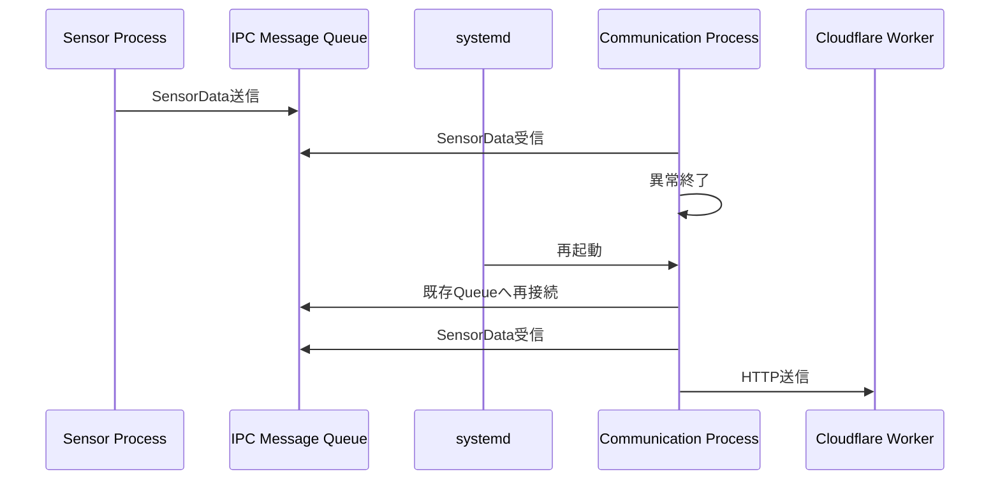

Communication Process再起動時には、Queueを新規生成しない。

Queue内に残存しているSensorDataは、Queueの仕様および障害復旧設計に従って扱う。

### 19.14 正常停止

Raspberry Piを正常にShutdownする場合、systemdが各Processの停止処理を実行する。

Shutdown時は、Process間のデータフローを考慮し、Sensor Processを先に停止し、その後Communication Processを停止する。

基本的な停止方針は以下とする。

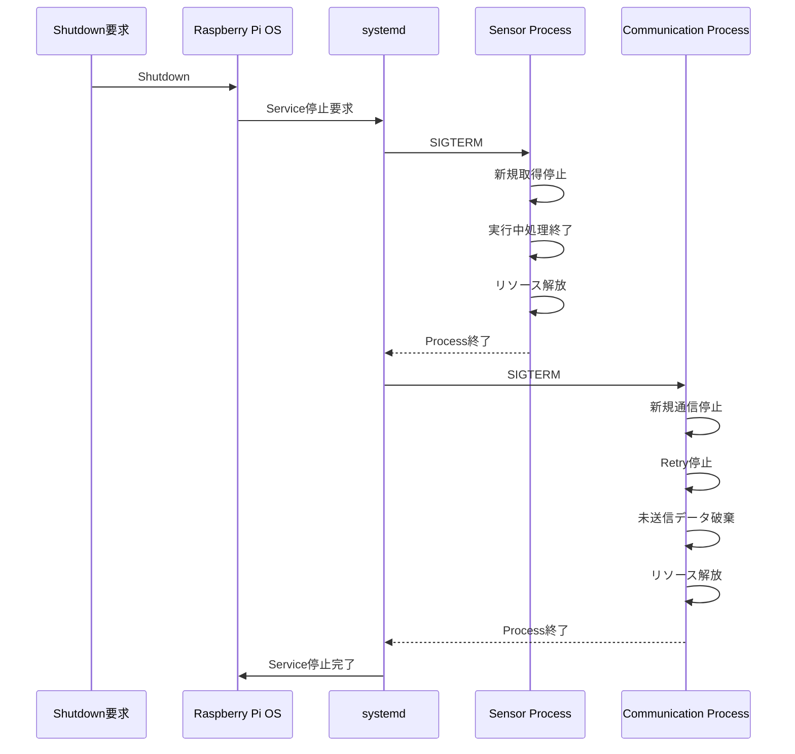

Process側は停止要求を受け取った場合、直ちに強制終了するのではなく、可能な範囲で正常終了処理を実行する。

### 19.15 Queue内データの扱い

正常停止時にIPC Message Queue内に未送信のSensorDataが存在する可能性がある。

本システムでは、Queue内の未送信SensorDataを永続化しない。

Shutdown時は以下の方針とする。

- Sensor Processの新規センサー取得を停止する。
- Sensor Processの新規Queue送信を停止する。
- Communication Processの新規通信を停止する。
- Retry中のSensorDataを破棄する。
- Queue内の未送信SensorDataを破棄する。
- Process終了時に必要なIPC関連リソースを解放する。

Shutdown完了時に未送信データが残っていても、次回起動時に復元送信しない。

この方針は、05章「運用・障害復旧設計」のLifecycle設計と整合させる。

### 19.16 systemdとIPCの関係

systemdはIPC Message Queueそのものをアプリケーションデータの受け渡し手段として使用するものではない。

systemdの役割はProcessのライフサイクル管理であり、Process間のデータ交換はIPC Message Queueが担当する。

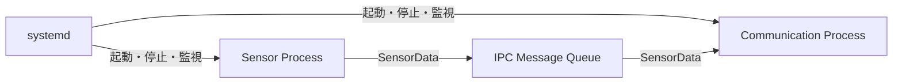

この役割分担を明確にする。

### 19.17 ログ管理

systemdで管理するProcessの標準出力および標準エラー出力は、systemd journalへ集約する構成を基本とする。

ログには少なくとも以下を含める。

- Process起動
- Process終了
- 初期化結果
- READY / RUNNINGへの状態遷移
- SensorData取得に関する異常
- IPCエラー
- Queue Full
- HTTP通信結果
- HTTPエラー
- Retry
- Backoff
- 復旧
- 異常終了
- Process再起動
- Shutdown処理
- リソース解放結果

通常のSensorData取得ごとに詳細ログを大量出力する構成にはしない。

正常処理については必要な情報に限定し、異常発生時には原因を追跡できる情報を出力する。

ログレベルは以下を基本とする。

| Log Level | 用途 |
|---|---|
| ERROR | Process継続が困難な異常、重大な処理失敗 |
| WARN | Retry、Backoff、復旧待ちなどの注意事項 |
| INFO | 起動、停止、状態遷移、主要イベント |
| DEBUG | 詳細な処理状況、開発・調査用情報 |

ログには秘密情報を出力しない。

ログの保存容量および保持期間は、Raspberry Piのストレージ容量を考慮し、journaldの保存設定によって管理する。

### 19.18 systemd Unitの概念構成

Sensor ProcessおよびCommunication Processをそれぞれ独立したsystemd Unitとして管理する。

```text
sensor-process.service
communication-process.service
```

各Unitには以下を定義する。

- 自動起動
- 異常終了時のRestart
- RestartSec
- StartLimitIntervalSec
- StartLimitBurst
- 実行ユーザー
- 実行グループ
- 環境変数ファイル
- Shutdown Timeout
- 必要なファイルアクセス権
- 必要なCapability
- 起動・停止順序

具体的なUnit設定では、本章で定義したsystemd設計方針を適用する。

### 19.19 systemdとセキュリティ

Processをsystemdから起動する際のユーザー権限、ファイルアクセス権、環境変数、通信認証情報などはセキュリティ設計と関連する。

詳細な認証情報管理方式は20章「セキュリティ設計」で定義する。

特に以下を対象とする。

- Process実行ユーザー
- 実行グループ
- ファイルアクセス権
- Worker認証情報
- APIキー等の秘密情報
- EnvironmentFileの利用
- 秘密情報のログ出力防止
- systemdによるProcess権限制御

### 19.20 Raspberry Pi再起動時の復旧

Raspberry Piが再起動した場合、OS起動後にsystemdが各Processを自動起動する。

基本的な復旧フローは以下とする。

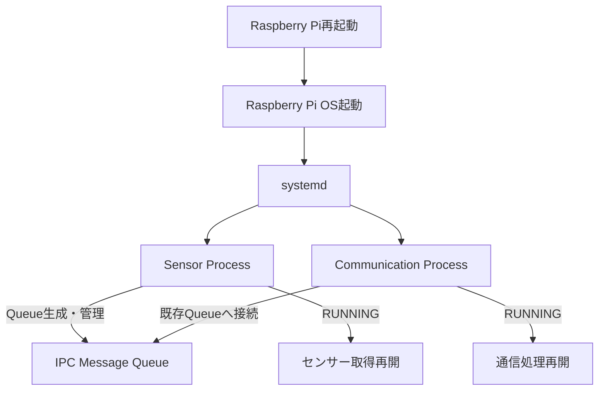

再起動前に存在していた未送信データは永続化せず、再起動後に復元送信しない。

OS起動後、Sensor ProcessはQueueを生成・管理し、Communication Processは既存Queueへ接続する。

Queueの初期化・接続が完了した後、各Processは通常処理へ移行する。

### 19.21 systemd設計方針

| 項目 | 決定値 |
|---|---|
| Unit | Sensor / Communicationの2 Unit |
| OS起動時 | 自動起動 |
| 異常終了 | 自動再起動 |
| Restart | `on-failure` |
| RestartSec | 5秒 |
| StartLimitIntervalSec | 60秒 |
| StartLimitBurst | 5回 |
| 正常終了 | 再起動しない |
| 実行ユーザー | 専用非rootユーザー |
| ログ | systemd journal |
| Network | 起動時の必須依存条件にしない |
| Queue生成 | Sensor Process |
| Queue接続 | Communication Process |
| Shutdown順序 | Sensor Process停止後にCommunication Process停止 |
| 未送信データ | 永続化しない |

### 19.22 設計上の判断

#### Decision

Sensor ProcessとCommunication Processを、それぞれ独立したsystemd Unitとして管理する。

#### Reason

Processを分離して管理することで、一方のProcessに異常が発生した場合でも、もう一方のProcessへの影響を抑制できる。

また、Raspberry Pi再起動後の自動復旧、およびProcess異常終了時の自動再起動をsystemdに担当させることができる。

#### Alternatives

- 1つのProcessとしてまとめる
- Sensor ProcessからCommunication Processを起動する
- 独自のProcess監視プログラムを作る

#### Why not

本システムではProcess分離による障害分離を重視する。

また、Process監視のためだけに独自の監視プログラムを追加すると、システム構成が複雑になるため、OS標準のsystemdを利用する。

### 19.23 本章で決定した事項

本章では以下を決定した。

1. Sensor ProcessとCommunication Processをsystemdの独立したUnitとして管理する。
2. Raspberry Pi OS起動時に両Processを自動起動する。
3. Process異常終了時はsystemdによる再起動を基本とする。
4. RestartSecは5秒とする。
5. StartLimitIntervalSecは60秒とする。
6. StartLimitBurstは5回とする。
7. 連続異常終了時はsystemdによる再起動を抑制する。
8. Process同士が相手Processを直接起動しない。
9. Communication Processはネットワーク未接続状態で起動する可能性を許容する。
10. Network Onlineを必須の起動条件としない。
11. Queueの生成・管理はSensor Processが担当する。
12. Communication Processは既存Queueへ接続し、Queue不存在時は接続を再試行する。
13. Process再起動時に既存Queueを無条件に削除・再生成しない。
14. Shutdown時はSensor Processを先に停止する。
15. Communication ProcessはSensor Process停止後に停止する。
16. 未送信データは永続化せず、Shutdown・再起動時に復元しない。
17. Processの正常停止処理をsystemdの停止処理と連携させる。
18. Processログはsystemd journalで確認できる構成を基本とする。
19. Process実行権限および秘密情報管理はセキュリティ設計で定義する。

---

## 20. セキュリティ設計

### 20.1 目的

本章では、本システムを構成するRaspberry Pi 4B、Wi-Fi / Internet、Cloudflare Worker、Cloudflare D1、およびBrowser間の通信・アクセスについて、基本的なセキュリティ方針を定義する。

対象とする主なセキュリティ要素は以下とする。

- 通信経路の保護
- Cloudflare Workerへのアクセス制御
- Raspberry Pi上のProcess権限
- 認証情報・秘密情報の保護
- ログへの秘密情報出力防止
- 不正なデータ送信への対策
- Browserからのアクセス制御
- 異常発生時の情報漏えい防止
- SensorDataの重複保存防止

本章では、Cloudflare WorkerおよびD1の内部実装そのものではなく、Edge Applicationと外部システムとの接続に必要なセキュリティ設計を対象とする。

### 20.2 セキュリティ境界

本システムでは、Raspberry Pi側とCloudflare側の間にInternetが存在する。

そのため、Raspberry PiからCloudflare Workerへの通信は、信頼できる閉域ネットワーク内の通信ではなく、外部ネットワークを経由する通信として扱う。

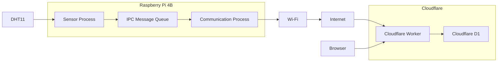

主なセキュリティ境界は以下とする。

1. Raspberry Pi内部とWi-Fiの境界
2. Wi-Fi / InternetとCloudflare Workerの境界
3. BrowserとCloudflare Workerの境界
4. Raspberry Pi上のProcess間の権限境界

### 20.3 基本セキュリティ方針

本システムでは、以下を基本方針とする。

- 通信経路は暗号化する。
- 外部から受信したデータは無条件に信頼しない。
- SensorData送信APIには認証を必須とする。
- Browserからの参照APIは公開アクセスを許可する。
- 認証情報をソースコードへ直接記述しない。
- 認証情報をログへ出力しない。
- Processには必要最小限の権限を与える。
- 異常時に不要な情報を外部へ返さない。
- セキュリティ情報を通常ログへ出力しない。
- Cloudflare Worker側でも受信データを検証する。
- D1へ直接アクセスできる構成にしない。
- SensorDataの重複保存を防止する。

### 20.4 通信経路の暗号化

Raspberry PiのCommunication ProcessからCloudflare Workerへの通信にはHTTPSを使用する。


HTTPSを使用することで、Internet上を通過するSensorDataについて通信内容の盗聴や改ざんに対する基本的な保護を行う。

HTTPによる平文通信は使用しない。

### 20.5 TLS証明書の検証

Communication ProcessはHTTPS通信時にTLS証明書を検証する。

証明書検証を無効化する構成は採用しない。

```text
HTTPS接続
    ↓
TLS証明書検証
    ↓
正常
    ├─ YES → HTTP通信開始
    └─ NO  → 通信失敗
```

証明書検証に失敗した場合は、Cloudflare Workerへの正常な通信とは扱わない。

TLS証明書検証エラーは、単純なネットワーク一時障害とは区別してログへ記録する。

証明書検証を無効化して通信を継続するようなFallbackは行わない。

### 20.6 Cloudflare Workerへのアクセス制御

Cloudflare WorkerはInternetからアクセス可能な外部サービスとして扱う。

本システムでは、APIの用途によってアクセス制御方針を分ける。

| API | アクセス方針 | 認証 |
|---|---|---|
| SensorData送信API | 正規のCommunication Processに限定 | 必須 |
| SensorData参照API | 公開アクセスを許可 | 不要 |

SensorData送信APIについては、正規のCommunication Processからの要求であることを確認する仕組みを設ける。

認証方式はShared Secret方式を採用する。

Browserからの参照APIは公開アクセスを許可するが、参照対象のデータおよび返却項目は必要な範囲に限定する。

### 20.7 SensorData送信APIの認証

SensorData送信APIでは専用HTTP HeaderへShared Secretを設定し、Cloudflare Worker側で認証する。

使用するHTTP Headerは以下とする。

```text
X-Edge-IoT-Shared-Secret
```

通信の流れを以下に示す。

```text
Communication Process
        ↓
HTTPS Request
        +
X-Edge-IoT-Shared-Secret
        ↓
Cloudflare Worker
        ↓
Shared Secret検証
        ↓
SensorData検証
        ↓
D1保存
```

Shared Secretが一致しない場合は認証失敗とし、SensorDataをD1へ保存しない。

認証情報はHTTP Headerに設定し、URLのQuery Parameterには含めない。

Shared Secretは十分なランダム性を持つ値を使用する。

認証に失敗した場合は、HTTP 401等の適切なステータスコードを返す。

### 20.8 Worker側での入力値検証

Cloudflare Workerは、Raspberry Piから受信したSensorDataをそのままD1へ保存しない。

少なくとも以下を検証する。

- 必須項目の存在
- JSON形式
- データ型
- 温度値の妥当性
- 湿度値の妥当性
- timestampの形式および妥当性
- data_idの形式および妥当性
- 不正な追加データ
- リクエストサイズ

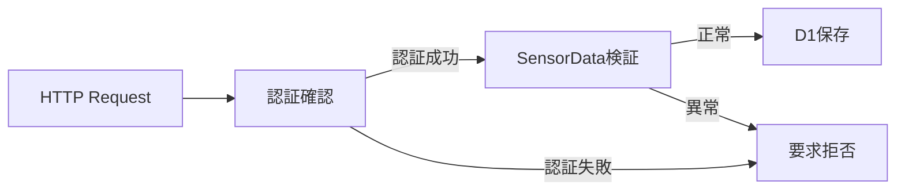

Edge Application側でもデータ検証を行うが、外部境界であるWorker側でも再度検証する。

不正な要求についてはD1へ保存しない。

JSONの必須項目や許容するデータ型は、04章「データ・IPC・通信設計」で定義したSensorDataの仕様と一致させる。

### 20.9 Browserからのアクセス

BrowserからのSensorData参照APIは公開アクセスを許可する。

Browser側に認証機構は設けない。

公開する情報はSensorDataの参照に必要な情報に限定する。

Worker側では、参照処理に必要なQuery Parameter、取得件数、データ形式などを検証する。

不正なQuery Parameterや過大な取得要求については拒否または制限する。

公開APIから以下の内部情報を取得できる構成にはしない。

- Shared Secret
- Worker内部の設定情報
- D1内部の接続情報
- SQL文
- 内部エラー情報
- 認証情報

### 20.10 D1へのアクセス制御

D1へのアクセスはCloudflare Workerからのみ行う構成を基本とする。

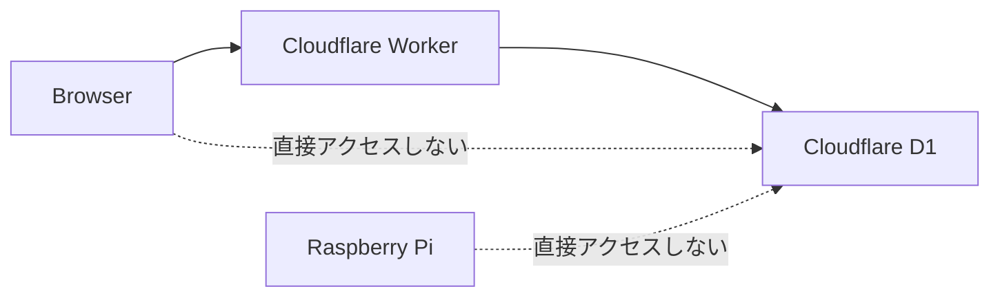

D1へのアクセス権限やBindingはWorker側で管理する。

BrowserやRaspberry PiからD1へ直接アクセスする構成は採用しない。

### 20.11 Raspberry Pi上のProcess権限

Sensor ProcessおよびCommunication Processには、必要最小限のOS権限を与える。

基本方針として、不要なroot権限でProcessを常時実行する構成は避ける。

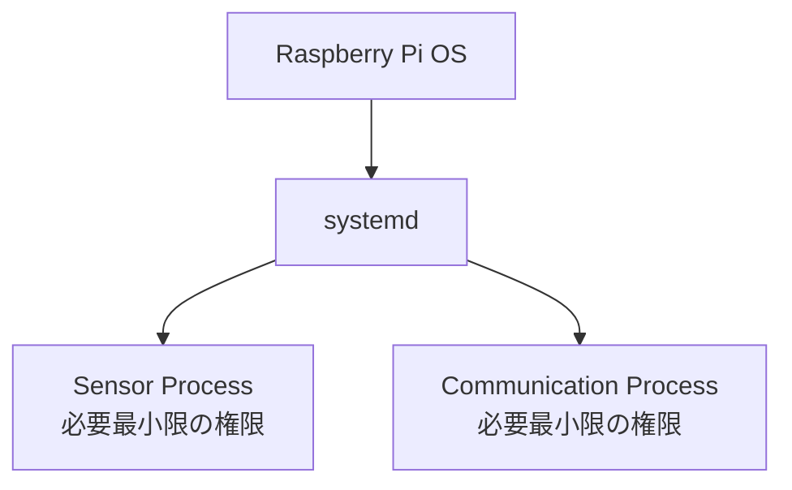

Sensor ProcessはDHT11へのアクセスに必要なGPIO権限を持つ。

Communication ProcessはIPCおよびHTTPS通信に必要な権限を持つ。

両Processとも専用の非rootユーザーで実行することを基本とする。

不要なOS権限やCapabilityを付与しない。

### 20.12 Process間の権限

Sensor ProcessとCommunication Processは、それぞれ独立したProcessとして動作する。

IPC Message Queueを介してデータを交換するため、Process間でメモリを直接共有する構成にはしない。


IPCへのアクセス権限についても、必要なProcessだけがアクセスできるようにする。

Queueのアクセス権限は、Sensor ProcessとCommunication Processの実行ユーザー・グループ構成と整合させる。

IPC Message Queueを不必要に一般ユーザーへ公開しない。

### 20.13 認証情報・秘密情報

Shared Secretは秘密情報として扱い、以下へ直接記述しない。

- C++ソースコード
- Gitリポジトリ
- 通常ログ
- README
- 設計書への実値記載
- 実行ファイルへの直接埋め込み

Raspberry Pi上では、systemdのEnvironmentFile等のOS側設定ファイルへ保管する。

本システムでは、Communication Processの認証情報を以下の環境変数から取得する。

```text
CLOUDFLARE_WORKER_URL
CLOUDFLARE_SHARED_SECRET
```

実際の設定ファイルは以下を基本とする。

```text
/etc/raspberry-pi-edge-iot/communication.env
```

設定ファイルには必要なアクセス権限を設定する。

基本方針は以下とする。

| 項目 | 方針 |
|---|---|
| 所有者 | root |
| グループ | edgeiot |
| Permission | 0640 |
| 読み取り | rootおよび許可されたグループ |
| Git管理 | 対象外 |

秘密情報を必要とするProcessだけが読み取れる構成とする。

### 20.14 Gitへの秘密情報登録防止

ソースコードをGitで管理する場合、認証情報をリポジトリへ登録しない。

```text
ソースコード
     │
     ├── Git管理
     │
     └── 秘密情報
           ↓
       Git管理対象外
```

設定ファイルを使用する場合も、実際の秘密情報を含むファイルをGit管理対象にしない。

必要に応じて、秘密情報を含まないサンプル設定ファイルを別途用意する。

サンプル設定ファイルには環境変数名や設定形式のみを記載し、実際のShared Secretは記載しない。

### 20.15 ログへの秘密情報出力防止

ログには以下の情報を出力しない。

- APIキー
- Bearer Token
- Shared Secret
- パスワード
- 秘密鍵
- Cookie
- Authorizationヘッダーの実値
- X-Edge-IoT-Shared-Secretの実値
- Wi-Fiパスワード

例えばHTTP通信ログでは、

```text
INFO HTTP POST /sensor-data
INFO HTTP response status=200
```

のように、通信結果を記録する。

一方、

```text
X-Edge-IoT-Shared-Secret: xxxxxxxxxxxxxxxxx
```

のような秘密情報そのものをログへ出力することは禁止する。

### 20.16 エラーレスポンス

Cloudflare WorkerからBrowserやCommunication Processへ返すエラーレスポンスには、内部情報を過剰に含めない。

特に以下を外部へ返さない。

- SQL文
- D1内部構造
- Worker内部の例外詳細
- APIキー
- Shared Secret
- 内部ファイルパス
- サーバー内部構成
- 内部接続情報

外部向けには、必要な範囲のエラー情報のみを返す。

内部の詳細なエラー原因についてはWorker側のログで管理する。

### 20.17 HTTPステータスコードとセキュリティ

Communication ProcessはHTTPステータスコードを利用して、要求結果を判定する。

基本方針は以下とする。

| HTTP結果 | 基本方針 |
|---|---|
| 2xx | 成功 |
| 400 | 要求内容の異常として扱う |
| 401 | 認証失敗として扱う |
| 403 | アクセス拒否として扱う |
| その他4xx | 原則Retryしない |
| 5xx | Worker側一時障害の候補 |
| Timeout | 通信異常 |
| DNS失敗 | 通信異常 |
| TLS失敗 | 証明書・TLS関連の異常 |
| 接続失敗 | 通信異常 |

4xxについては、認証失敗や入力値異常などの可能性があるため、無条件にRetryしない。

5xxやTimeoutなどの一時的障害については、Retry / Backoffを行う。

TLS証明書検証失敗については、証明書検証を無効化して通信を継続することはしない。

エラーの種類に応じて、恒久的な異常と一時的な異常を区別する。

### 20.18 SensorDataの重複送信・重複保存への対策

HTTP通信では、以下のような状況が発生する可能性がある。

```text
Communication Process
        ↓
SensorData送信
        ↓
Cloudflare Worker
        ↓
D1保存成功
        ↓
Response受信前にTimeout
        ↓
Communication Process Retry
        ↓
同一SensorData再送信
```

この場合、最初のRequestでD1への保存が成功していても、Communication Process側ではTimeoutとして認識する可能性がある。

そのため、Retryによる同一SensorDataの重複保存を防止する必要がある。

本システムでは、`data_id` と `timestamp` の複合キー方式を採用する。

#### 重複判定

重複判定には以下の2項目を使用する。

- data_id
- timestamp

同一の `data_id` と `timestamp` を持つSensorDataは同一データとして扱う。

Worker側では、この複合キーによってD1への重複保存を防止する。

D1側では、複合キーの一意性を保証できる制約または同等の処理を適用する。

#### Retry時の扱い

Retry時には、以下を維持する。

- data_idを変更しない。
- timestampを変更しない。
- 温度・湿度などのSensorDataを変更しない。

同一SensorDataを再送信しても、Worker側で同一データとして判定できる構成とする。

#### 注意事項

この方式は、通信Retryによる重複保存を防止するための冪等性確保を目的とする。

複合キーによる重複排除だけで、すべてのリプレイ攻撃を防止できるものではない。

不正な送信への対策は、HTTPS、Shared Secret認証、Worker側の入力値検証と組み合わせて実施する。

### 20.19 Wi-Fiのセキュリティ

Raspberry Piから外部ネットワークへ接続するため、Wi-Fi接続自体についても適切な暗号化方式を使用する。

Wi-FiのSSIDやパスワードなどの接続情報は秘密情報として扱う。

これらをソースコードやGitリポジトリへ直接記述しない。

### 20.20 Raspberry PiのOSセキュリティ

Raspberry Pi OSについて、以下を基本方針とする。

- OSを適切に更新する。
- 不要なサービスを有効化しない。
- 不要なポートを開放しない。
- Processを必要最小限の権限で実行する。
- SSH等を使用する場合は適切にアクセス制御する。
- 不要なユーザー・権限を作成しない。
- 不要なソフトウェアを導入しない。

本システムのEdge Application以外のOSサービスについても、可能な範囲で不要な攻撃面を減らす。

### 20.21 systemdのセキュリティ

systemd Unitについても、Processの権限を必要以上に広げない。

Unit設計では、以下のセキュリティ要件を適用する。

- 実行ユーザー
- 実行グループ
- ファイルアクセス権
- 読み取り専用領域
- 書き込み可能領域
- Processの権限制限
- 必要なCapability
- 環境変数ファイルへのアクセス権

過度なsystemdセキュリティ設定によってセンサーアクセスやIPC利用を妨げないよう、必要な権限だけを付与する。

### 20.22 データの機密性と公開範囲

本システムで扱うSensorDataは、一般的な個人情報や認証情報とは異なる。

本システムでは、BrowserからのSensorData参照APIについて公開アクセスを許可する。

ただし、公開する情報はSensorDataの参照に必要な範囲に限定する。

```text
SensorData
   ↓
公開対象データ
   ↓
Browserへ提供

内部情報・秘密情報
   ↓
Browserへ提供しない
```

公開対象とする情報は以下を基本とする。

- 温度
- 湿度
- timestamp
- data_id（参照に必要な場合）

Worker内部の情報、認証情報、D1の内部構造などは公開しない。

### 20.23 可用性とセキュリティのバランス

セキュリティ対策を強化しすぎることで、システムの運用性を損なわないようにする。

例えば認証情報を変更した場合に、Communication Processが認証エラーによって通信できなくなる可能性がある。

そのため、以下のように原因を追跡できる構成とする。

```text
認証情報変更
    ↓
Communication Process
    ↓
認証失敗
    ↓
HTTP Status確認
    ↓
ログで原因確認
    ↓
設定修正
    ↓
Process再起動
    ↓
通信復旧
```

認証失敗は、無条件に通信Retryを繰り返す対象とはしない。

設定修正などの対応が必要な恒久的な異常として扱う。

ただし、ログへ秘密情報そのものを出力してはいけない。

### 20.24 セキュリティイベントのログ

以下のセキュリティ上重要なイベントはログに記録する。

- 認証失敗
- TLS接続失敗
- 不正なSensorData
- 不正なHTTP要求
- HTTP 4xx
- HTTP 5xx
- 通信異常
- Process異常終了
- Process再起動

認証成功については、正常なSensorData送信ごとに専用の認証成功ログを出力する必要はない。

HTTP通信結果やWorkerからの正常応答によって、必要な範囲で成功を確認する。

認証失敗については、発生時刻、対象API、HTTP Statusなど、原因調査に必要な情報を記録する。

ただし、Shared Secretや認証Headerの実値は記録しない。

また、同一の異常が大量発生した場合にログが過剰に増加しないよう、ログ出力頻度を考慮する。

### 20.25 セキュリティ設計方針

本システムでは以下を基本方針とする。

| 項目 | 方針 |
|---|---|
| Pi → Worker通信 | HTTPS |
| TLS証明書 | 検証する |
| WorkerへのSensorData送信 | Shared Secret認証必須 |
| 認証Header | X-Edge-IoT-Shared-Secret |
| Browser → 参照API | 公開アクセスを許可 |
| Worker入力 | 受信側でも検証する |
| Browser → D1 | 直接アクセスしない |
| Raspberry Pi → D1 | 直接アクセスしない |
| Worker → D1 | Worker経由 |
| Process権限 | 最小権限 |
| IPC | 必要なProcessのみ利用 |
| APIキー等 | ソースコードへ埋め込まない |
| Shared Secret | EnvironmentFileで管理 |
| Git | 秘密情報を登録しない |
| ログ | 秘密情報を出力しない |
| Error Response | 内部情報を公開しない |
| Wi-Fi情報 | 秘密情報として管理 |
| OS | 適切に更新 |
| 不要サービス | 無効化を検討 |
| 認証失敗 | 記録・拒否 |
| 不正データ | Worker側でも拒否 |
| 重複排除 | data_id + timestampの複合キー |

### 20.26 設計上の判断

#### Decision

Raspberry PiからCloudflare Workerへの通信にはHTTPSを使用し、Worker側でShared Secret認証および受信データの検証を行う。

BrowserからのSensorData参照APIについては公開アクセスを許可し、SensorData送信APIとはアクセス制御を分離する。

SensorDataの重複保存については、`data_id` と `timestamp` の複合キー方式を採用する。

#### Reason

Raspberry PiからWorkerまでの通信はInternetを経由するため、通信経路の暗号化だけでなく、正規の送信要求であることを確認する仕組みが必要となる。

また、Raspberry Pi側で検証したSensorDataであっても、外部境界であるWorker側で再検証することで、不正データのD1保存を防止できる。

HTTP TimeoutなどによるRetryでは、同一SensorDataが複数回送信される可能性がある。

そのため、data_idとtimestampの複合キーによって同一データを識別し、重複保存を防止する。

Browserからの参照APIについては、システムの利用形態を考慮して公開アクセスを許可する一方、内部情報および秘密情報を公開しない構成とする。

#### Alternatives

- HTTPSのみで認証しない。
- Worker URLを知っている端末からのアクセスを無条件に許可する。
- Raspberry PiのIPアドレスだけで送信元を判断する。
- data_id単独で重複排除する。
- SensorData参照APIにも認証を必須とする。

#### Why not

WorkerはInternetからアクセス可能なため、URLだけを知っている第三者からの要求を正規要求として扱うことは適切ではない。

また、IPアドレスだけによる送信元判定は、安定した認証方式とはならないため採用しない。

data_id単独ではなく、04章で決定したdata_idとtimestampの複合キー方式に統一する。

SensorData参照APIについては公開アクセスを許可する設計とし、送信APIとは異なるアクセス制御方針を適用する。

### 20.27 本章で決定した事項

本章では以下を決定した。

1. Raspberry PiからCloudflare Workerへの通信にはHTTPSを使用する。
2. TLS証明書検証を有効にする。
3. TLS証明書検証を無効化するFallbackは行わない。
4. SensorData送信APIにはShared Secret認証を必須とする。
5. Shared Secretは `X-Edge-IoT-Shared-Secret` Headerで送信する。
6. Worker側でShared Secretを検証する。
7. 認証失敗時はSensorDataをD1へ保存しない。
8. Worker側でSensorDataの入力値検証を行う。
9. BrowserからのSensorData参照APIは公開アクセスを許可する。
10. 公開APIから内部情報・秘密情報を取得できない構成とする。
11. D1へのアクセスはCloudflare Worker経由に限定する。
12. Raspberry PiおよびBrowserからD1へ直接アクセスしない。
13. Processは必要最小限の権限で実行する。
14. IPC Message Queueのアクセス権限を適切に制限する。
15. Shared SecretはEnvironmentFileで管理する。
16. 秘密情報をソースコードやGitリポジトリへ登録しない。
17. ログに認証情報や秘密情報を出力しない。
18. Workerのエラーレスポンスに内部情報を含めない。
19. HTTP 4xxは原則Retryしない。
20. HTTP 5xx、Timeoutなどの一時的な通信異常はRetry / Backoffの対象とする。
21. Wi-Fi接続情報も秘密情報として管理する。
22. Raspberry Pi OSを適切に更新し、不要なサービスを無効化する。
23. セキュリティイベントをログで追跡できる構成とする。
24. 認証成功については、正常送信ごとの専用ログ出力を行わない。
25. SensorDataの重複保存防止にはdata_idとtimestampの複合キー方式を使用する。
26. Retry時にはdata_id、timestampおよびSensorDataの内容を変更しない。
27. 複合キーによる重複排除は通信Retryの冪等性確保を目的とし、すべてのリプレイ攻撃を防止するものではない。